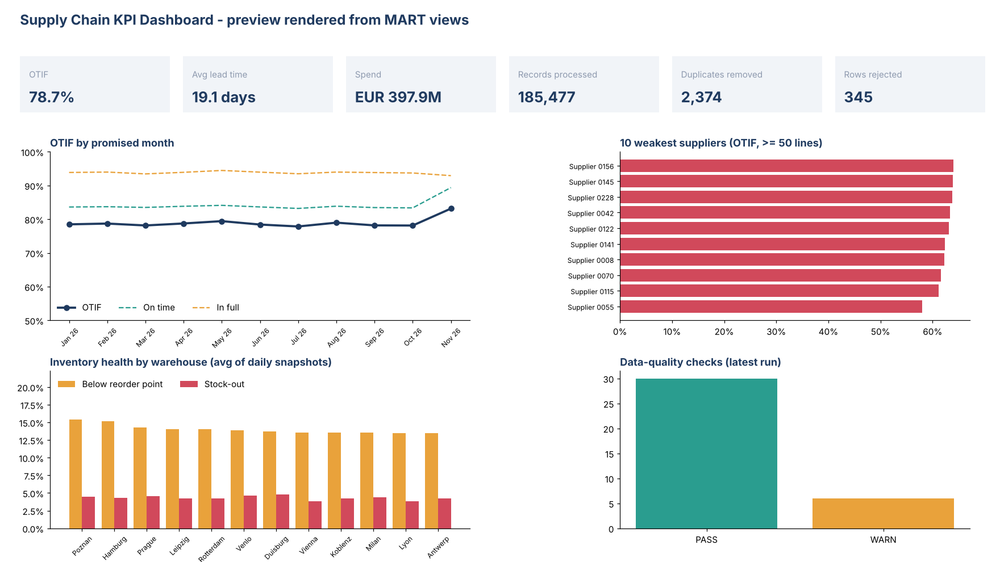
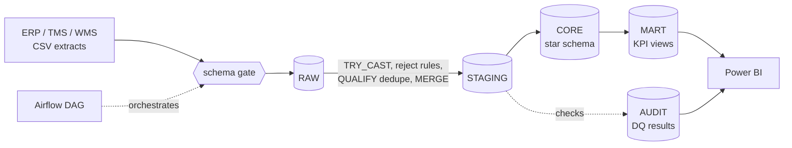

# Supply Chain Data Warehouse & Reporting

SQL pipelines that load ERP / TMS / WMS extracts into **Snowflake**, with automated **schema and duplicate
checks**, orchestrated by **Apache Airflow** and feeding **Power BI** KPI dashboards (OTIF, lead time, supplier
scorecard, inventory health). Built and tested on **185,000+ records** with deliberately planted data problems.

[](https://github.com/Harsha-1306/supply-chain-dw/actions/workflows/ci.yml)

**Live dashboard:** `site/index.html` – a static KPI dashboard generated from the MART views
(`python -m scdw dashboard`), hosted on Vercel. It stands in for the Power BI report, which needs a Power BI licence
to view. Every figure shows how it was calculated (e.g. `OTIF = 41,040 / 52,180 closed lines`).





## What it does

- **SQL pipelines into Snowflake** – RAW → STAGING → CORE (star schema) → MART views, all plain SQL. Loading uses
  `PUT` + `COPY INTO` from a stage; staging uses `MERGE` with `QUALIFY ROW_NUMBER()` so the newest version of
  each record wins and re-runs are idempotent.
- **Automated schema checks** – each feed has a data contract (`scdw/contracts/sources.yml`). Headers are checked
  before loading (a renamed column stops the whole batch); every value is type-checked with `TRY_CAST`, and rows
  breaking a rule go to `STAGING.REJECTED_ROWS` with the reason.
- **Automated duplicate checks** – exact duplicate rows and duplicate business keys are counted per batch,
  resolved by version, and uniqueness is asserted after every MERGE (Snowflake does not enforce primary keys).
  Re-delivered files are skipped by MD5.
- **Airflow** – DAG `supply_chain_dw`: wait for extract → schema gate → load RAW → staging → core → marts →
  post-load checks → export + Power BI refresh. Quality-gate failures fail fast without retries.
- **Power BI** – star-schema model, DAX measures and theme in [`powerbi/`](powerbi), refresh triggered by the DAG
  through the Power BI REST API. Results of all checks are exposed so the dashboard shows whether the data can be
  trusted.

Details: [architecture](docs/architecture.md) · [data-quality checks](docs/data_quality.md) ·
[KPI definitions](docs/kpi_definitions.md) · [Power BI model](powerbi/README.md)

## Run it locally (no Snowflake account needed)

The same SQL runs on DuckDB locally and in CI; set `SCDW_ENGINE=snowflake` to run against Snowflake.

```bash
pip install -r requirements-dev.txt
make all        # generate 185k records -> run pipeline -> export MART views -> build site/index.html
make test       # 41 tests (4 of them need Airflow installed: DAG structure)
make sql-check  # parse every SQL statement with the Snowflake grammar
make airflow    # Airflow UI on http://localhost:8080 with the DAG (Docker)
```

Sample run:

```text
STAGING.purchase_orders: raw 55,990 | exact dup rows 550 | duplicate keys resolved 825 | rejected 165 | loaded 55,000
STAGING.shipments:       raw 61,576 | exact dup rows 600 | duplicate keys resolved 1,200 | rejected 180 | loaded 60,196
post-load checks: orphan_supplier WARN, orphan_shipment WARN, fact_null_keys PASS, volume PASS (182,758 records)
```

## Run against Snowflake

1. Run `snowflake/00_setup.sql` (roles, warehouses, database, schemas, file format, stage, grants, resource monitor).
2. Copy `.env.example` to `.env` and fill in the `SNOWFLAKE_*` values (key-pair auth recommended).
3. `SCDW_ENGINE=snowflake python -m scdw run data/landing/batch_001`
   – or in Airflow, create the `snowflake_default` connection and set `SCDW_ENGINE=snowflake`.

## Repository layout

```text
scdw/
  contracts/sources.yml   data contracts: columns, types, keys, rules, reject thresholds
  staging.py              contract-generated RAW/STAGING SQL (DDL, TRY_CAST, rejects, MERGE)
  sql/core, sql/mart      star schema and KPI views
  checks.py               schema, duplicate, reconciliation, referential and volume checks
  pipeline.py             pipeline steps (shared by Airflow, CLI and tests)
  warehouse.py            Snowflake and DuckDB adapters
  generate.py             synthetic ERP/TMS/WMS extracts with planted data problems
  report.py, powerbi.py   MART exports, dashboard preview, Power BI refresh
  dashboard.py            static KPI dashboard (site/index.html) from the MART views
site/index.html           generated dashboard, deployed to Vercel (Root Directory = site)
dags/supply_chain_dw.py   Airflow DAG
snowflake/00_setup.sql    Snowflake objects, RBAC, resource monitor
powerbi/                  model, DAX measures, theme
tests/                    end-to-end and unit tests
```

## Tech

Snowflake · SQL (MERGE, QUALIFY, window functions) · Python 3.12 · Apache Airflow 3 (TaskFlow, task groups,
sensors) · Power BI (DAX, REST API refresh) · DuckDB · pytest · sqlfluff · Ruff · Docker · GitHub Actions
