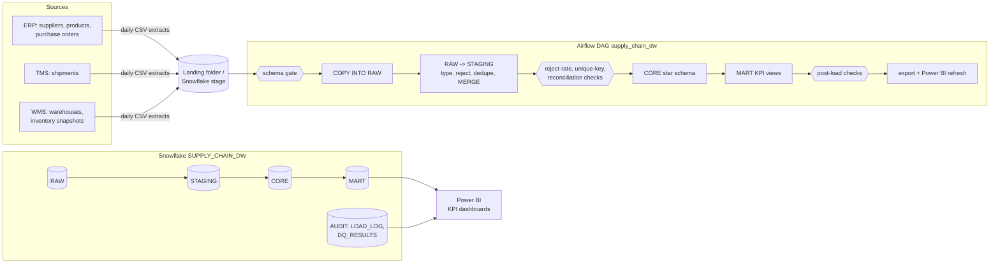

# Architecture

## Layers

| Schema | Content | Written by |
|---|---|---|
| RAW | One table per feed, every source column as `VARCHAR` + `_batch_id`, `_source_file`, `_loaded_at`. Nothing is lost, even malformed values. | `COPY INTO` (Snowflake) / `read_csv` (DuckDB) |
| STAGING | Typed, validated, one row per business key. `REJECTED_ROWS` holds every rejected row with its reason. | Contract-generated SQL (`scdw/staging.py`) |
| CORE | Star schema: `DIM_SUPPLIER`, `DIM_PRODUCT`, `DIM_WAREHOUSE`, `DIM_DATE`, `FACT_PO_LINE`, `FACT_SHIPMENT`, `FACT_INVENTORY_SNAPSHOT`, `FX_RATES`. | `scdw/sql/core/*.sql` |
| MART | KPI views for Power BI: OTIF, supplier scorecard, inventory health, inbound, DQ scorecard, load summary. | `scdw/sql/mart/*.sql` |
| AUDIT | `LOAD_LOG` (per batch/table counts, file MD5) and `DQ_RESULTS` (every check of every run). | pipeline |

## Key design decisions

- **Data contracts drive the SQL.** `scdw/contracts/sources.yml` declares columns, types, keys and rules once;
  RAW/STAGING DDL, casting, reject rules and MERGE statements are generated from it, so six feeds share one
  tested pattern. Adding a feed = adding a contract.
- **RAW keeps everything as text.** Type problems become rejected rows with a reason instead of failed loads.
- **Duplicates are resolved deterministically.** `QUALIFY ROW_NUMBER() OVER (PARTITION BY <key> ORDER BY
  updated_at DESC, _loaded_at DESC) = 1` picks the newest version; the MERGE only overwrites when the incoming
  version is newer, so late or re-sent files can never roll data back.
- **Uniqueness is checked, not assumed.** Snowflake does not enforce `PRIMARY KEY` constraints, so a check after
  every MERGE asserts one row per key.
- **Idempotent.** A file whose MD5 was already loaded is skipped; re-running a task deletes and re-lands only
  its own batch; MERGE makes the staging step repeatable.
- **All-or-nothing schema gate.** Every file of a batch is checked before any is loaded, so the warehouse never
  holds a half-loaded day.
- **Unknown members instead of dropped rows.** Facts with an unknown supplier/PO are kept (mapped to
  `UNKNOWN`) and counted by referential-integrity checks, so totals still reconcile with the source.
- **One SQL dialect subset, two engines.** The SQL runs unchanged on Snowflake and on DuckDB (MERGE, QUALIFY,
  TRY_CAST, DATEDIFF, DATE_TRUNC), which gives a fast local/CI run without a Snowflake account. All SQL is also
  parsed with the Snowflake grammar in CI (`scripts/check_snowflake_sql.py`).
- **Separate warehouses and roles.** `SCDW_WH`/`SCDW_LOADER` for the pipeline, `SCDW_BI_WH`/`SCDW_REPORTER`
  (MART only) for Power BI; a resource monitor caps credits.
